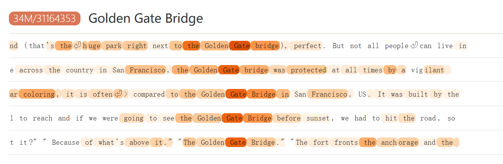

来源：Scaling Monosemanticity: Extracting Interpretable Features from Claude 3 Sonnet

#### SAE(稀疏自编码器)

把每个token的隐藏状态映射成一个很长、但大部分为0的特征激活向量。

- 输入一个token的隐藏状态，作scalar normalization：$$x\in\mathbb R^D $$

- **编码器**算出多个特征的激活值：$$f(x)=\operatorname{ReLU}(W_{\mathrm{enc}}x+b_{\mathrm{enc}}) \in\mathbb R^F $$
  - 其中$$W_{enc}$$的形状为F×D，每一行对应一个特征的检验权重。

- **解码器**用这些激活值重建输入：$$\hat x=b_{\mathrm{dec}}+\sum_i f_i(x)d_i $$

  > x ≈ b + f1d1(特征1的贡献) + f2d2...，特征数为F

  - di：第i个特征的解码方向
  - 训练要求：重建准确，即尽量接近x；激活稀疏，尽量用少量特征完成重建
  - $$\mathcal L= \mathbb E_x\left[ \|x-\hat x\|_2^2+ \lambda\sum_i f_i(x)\|d_i\|_2 \right] $$

****

#### Four Examples of Interpretable Features

以金门大桥为例：来自34M特征的SAE / 特征编号31164353

颜色表示这个特征在每个token位置的激活强度，只表示，读到这个位置时，该特征有多活跃。

多段高激活文本都涉及金门大桥，因此**该特征与金门大桥相关**是一个合理的初步解释。

- Specificity：特征激活时，上下文是否可靠地包含对应概念？
- Influence on behavior：人为改变特征激活，是否会引起与该概念相关的输出变化？

****

#### Influence on Behavior

> 输入不变，人为增强这个特征，模型的回答是否会朝金门大桥相关内容变化？

作者把金门大桥特征固定到观测最大激活的 10 倍，模型甚至开始把自己描述成金门大桥。这支持了该特征确实影响相关行为的解释。

设编码得到 $$f(x)$$，第 $$i$$ 个特征的解码向量是 $$d_i$$。希望把它的激活从 $$f_i(x)$$ 改成指定值 $$c$$，就得到：从而调整固定特征的激活(x中已经包含了$$f_i(x)d_i$$)
$$
\boxed{x'=x+\big(c-f_i(x)\big)d_i}
$$

****

#### 